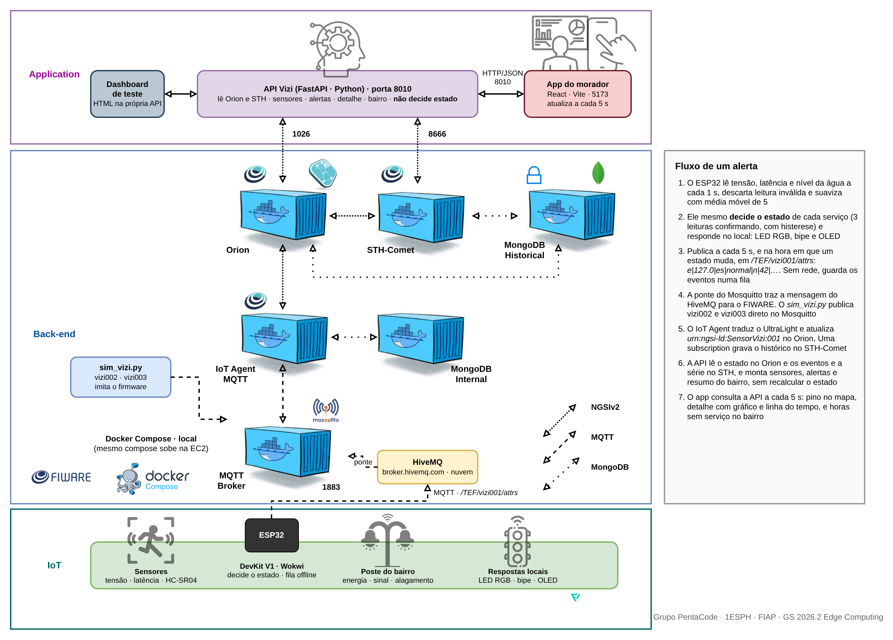

# Vizi · Sensor de bairro — GS 2026.2 Edge Computing

> Quando falta, o bairro avisa.

Sensor de poste com ESP32 que mede três serviços essenciais do bairro: **energia** (tensão do poste), **sinal** (latência da rede) e **alagamento** (nível da água na rua). O próprio sensor **decide o estado** de cada serviço, avisa no local (LED, bipe e tela) e publica no FIWARE. A API e o app do morador transformam essa leitura em alerta no mapa do bairro, com o tempo sem serviço.

**Simulação no Wokwi:** <https://wokwi.com/projects/480517327895249921>

## Integrantes — Grupo PentaCode (1ESPH)

| Nome | RM |
|---|---|
| Andre Luiz | 573575 |
| Arthur Jircik Cronemberger | 570754 |
| Felipe Garcia | 571741 |
| Guilherme Amorim | 569024 |
| Matheus Marcelino Morais | 571472 |

## A solução

| | |
|---|---|
| **Cidadão** | Morador de bairro periférico (Campo Limpo, zona sul de São Paulo) que fica sem energia, sem sinal ou com a rua alagada |
| **Problema** | Quando um serviço falta, ninguém sabe se é só na sua casa, há quanto tempo está assim nem como provar isso para cobrar a empresa |
| **Onde fica** | Preso ao poste da rua, a 2 m do chão, com o sensor ultrassônico apontado para a calçada |
| **ODS** | 11 (cidades sustentáveis), 9 (infraestrutura), 10 (redução das desigualdades) e 13 (clima: alagamentos) |

Muitos desses problemas acontecem justamente onde a rede é fraca. Por isso o sensor **funciona sozinho**: lê, suaviza, decide e reage no local mesmo sem internet. Sem rede, ele guarda os eventos numa fila e envia tudo quando a conexão volta.

- **Sensores:** potenciômetro de tensão (faz o papel de um ZMPT101B), potenciômetro de latência e HC-SR04 para o nível da água, lidos a cada 1 s.
- **Decisão na borda:** média móvel de 5 leituras, troca de estado só depois de 3 leituras confirmando, histerese na volta e descarte de leitura inválida.
- **Respostas locais:** LED RGB de status, bipe único ao entrar em falha e display OLED com as leituras, para o técnico de manutenção.
- **Conectado:** publica no FIWARE, e o app do morador mostra o alerta no mapa em poucos segundos.

## Arquitetura



A arquitetura segue as três camadas pedidas (device IoT, back-end FIWARE e aplicação). O arquivo editável está em [`docs/arquitetura.drawio`](docs/arquitetura.drawio) (abre no draw.io).

- **IoT:** ESP32 no Wokwi. Publica em `/TEF/vizi001/attrs` no formato UltraLight 2.0, pelo broker público `broker.hivemq.com`.
- **Back-end (Docker Compose):** Mosquitto (1883) com ponte para o HiveMQ, IoT Agent UltraLight (4041), Orion Context Broker (1026), STH-Comet (8666) e dois MongoDB. O simulador `sim_vizi.py` publica mais dois sensores (`vizi002` e `vizi003`) direto no Mosquitto, para o mapa ter um bairro inteiro.
- **Aplicação:** API Vizi em FastAPI (8010), que lê o Orion e o STH-Comet, e o app do morador em React (5173), que consulta a API a cada 5 s. A API também serve um dashboard de teste simples.

**Regra principal:** quem decide o estado é o ESP32. A API e o app só mostram o que o sensor decidiu e nunca recalculam a partir de tensão, latência ou nível.

### Fluxo de um alerta

1. O ESP32 lê os sensores a cada 1 s, descarta leitura inválida e calcula a média móvel.
2. Com 3 leituras seguidas fora da faixa, ele muda o estado (ex.: energia `normal` → `sem_energia`), acende o LED vermelho, toca o bipe e atualiza o OLED.
3. Na hora da mudança ele publica o evento `ev|energia,sem_energia,104.4,0` e a telemetria `e|104.4|es|sem_energia|n|42|ns|ok|a|0.0|as|normal|g|critico|te|0|tn|0|q|0`. Fora isso, publica a cada 5 s.
4. A ponte do Mosquitto traz a mensagem do HiveMQ. O IoT Agent atualiza a entidade `urn:ngsi-ld:SensorVizi:001` no Orion, e uma subscription grava o histórico no STH-Comet.
5. A API monta o alerta "Sem energia · Poste 01 - Rua das Flores", com a série dos últimos minutos e a linha do tempo dos eventos.
6. O app do morador mostra o pino no mapa e o card do alerta. Quando a tensão volta, o ESP32 publica `normal` e o alerta some.

## Manual do hardware

### Componentes

| Componente | Quantidade | Função |
|---|---|---|
| ESP32 DevKit V1 | 1 | Controlador, Wi-Fi e MQTT |
| Potenciômetro | 2 | Tensão do poste (0 a 150 V) e latência da rede (0 a 2000 ms) |
| Sensor ultrassônico HC-SR04 | 1 | Distância até a rua; nível da água = 200 cm − distância |
| Chave deslizante | 1 | Simular queda de rede |
| LED RGB catodo comum | 1 | Status: verde normal, amarelo atenção, vermelho falha, azul piscando sem rede |
| Resistores 220 Ω | 3 | Um por cor do LED RGB |
| Buzzer | 1 | Bipe único ao entrar em falha |
| Display OLED SSD1306 I2C | 1 | Tela de manutenção com leituras e estados |

### Ligações

| Componente | Pino do ESP32 |
|---|---|
| Potenciômetro de tensão | GPIO 34 |
| Potenciômetro de latência | GPIO 35 |
| Chave "simular queda de rede" | GPIO 27 |
| HC-SR04 — TRIG / ECHO | GPIO 13 / 14 |
| LED RGB — vermelho / verde / azul | GPIO 26 / 25 / 33 |
| Buzzer | GPIO 32 |
| OLED — SDA / SCL | GPIO 22 / 21 |

O SDA e o SCL estão trocados em relação ao padrão (21/22) só para o diagrama ficar sem fios cruzados; o ESP32 aceita I2C em qualquer pino. O circuito completo está em [`firmware/diagram.json`](firmware/diagram.json).

### Limites e estados

| Serviço | Normal | Atenção | Falha |
|---|---|---|---|
| **Energia** (rede 127 V, faixas da ANEEL PRODIST Módulo 8) | 117 a 133 V | `instavel`: 110 a 117 V ou acima de 133 V | `sem_energia`: abaixo de 110 V |
| **Sinal** | `ok`: abaixo de 300 ms | `instavel`: 300 a 1000 ms ou falha recente | `sem_sinal`: 3 falhas seguidas ou chave de queda ligada |
| **Água** (meio-fio padrão de SP tem ~15 cm) | abaixo de 8 cm | `atencao`: 8 a 15 cm | `alagamento`: acima de 15 cm |

- **Leitura inválida:** eco ausente, distância maior que a altura do poste ou ADC saturado. A leitura é descartada, e 5 inválidas seguidas levam o serviço a `erro_sensor`.
- **Estado geral:** `normal`, `atencao` ou `critico`, conforme o pior serviço.
- **Histerese:** 2 V, 30 ms e 1,5 cm na volta, para não ficar oscilando no limite.

### Firmware

O código está em [`firmware/sketch.ino`](firmware/sketch.ino), com as bibliotecas em [`firmware/libraries.txt`](firmware/libraries.txt): PubSubClient, Adafruit GFX e Adafruit SSD1306. Tudo usa `millis()`, sem `delay` no loop. O Monitor Serial (115200) mostra cada leitura (`[LEITURA]`), cada troca de estado (`[ESTADO]`), os envios (`[MQTT]`), a fila offline (`[FILA]`) e os avisos de leitura inválida (`[AVISO]`).

No início do arquivo:

- `WIFI_SSID`: `Wokwi-GUEST`, sem senha, no canal 6 (conecta mais rápido no Wokwi).
- `BROKER_MQTT`: `broker.hivemq.com`. Para mandar direto para uma EC2, troque pelo IP público dela.

### Payload UltraLight 2.0

Telemetria e eventos vão no mesmo tópico, `/TEF/vizi001/attrs`:

| Objeto | Atributo no Orion | Valores |
|---|---|---|
| `e` / `es` | `tensao` / `estadoEnergia` | V / `normal`, `instavel`, `sem_energia`, `erro_sensor` |
| `n` / `ns` | `latencia` / `estadoSinal` | ms / `ok`, `instavel`, `sem_sinal` |
| `a` / `as` | `nivelAgua` / `estadoAgua` | cm / `normal`, `atencao`, `alagamento`, `erro_sensor` |
| `g` | `estadoGeral` | `normal`, `atencao`, `critico` |
| `te` / `tn` | `minutosSemEnergia` / `minutosSemSinal` | acumulado |
| `q` | `filaOffline` | eventos esperando rede |
| `ev` | `evento` | `servico,estado,valor,atraso_s` |

O formato completo, do ESP32 até a API, está em [`docs/contrato-dados.md`](docs/contrato-dados.md).

## Manual do software

Os comandos partem da pasta `edge/`. São necessários Docker, Python 3.10+ e Node 18+.

### 1. FIWARE (Docker)

```bash
cd fiware
docker compose up -d
python3 -m venv .venv && .venv/bin/pip install -r requirements.txt
.venv/bin/python provision.py        # service group, 3 sensores e subscription do STH (uma vez)
.venv/bin/python sim_vizi.py --calmo # vizi002 e vizi003 (deixe rodando)
```

O `provision.py` cria o service group (apikey `TEF`, `cbroker` `http://orion:1026`), os três devices com os atributos do payload e a subscription do Orion para o STH-Comet. Todas as chamadas usam os headers `fiware-service: smart` e `fiware-servicepath: /`.

Modos do simulador:

| Comando | Uso |
|---|---|
| `sim_vizi.py --calmo` | Sensores sempre normais. Bom para gravar a demo do Wokwi sem outros alertas na tela |
| `sim_vizi.py --rapido` | Incidentes frequentes (quedas, oscilação, chuva) para encher o mapa |
| `sim_vizi.py --com-wokwi` | Simula também o `vizi001`, se o Wokwi estiver fora do ar |

### 2. Device (Wokwi)

Abra o [projeto no Wokwi](https://wokwi.com/projects/480517327895249921) e dê play. Em alguns segundos o Serial mostra `[REDE] broker conectado` e o `vizi001` passa a publicar.

- Deixe a aba do Wokwi visível. Em segundo plano o Chrome reduz a velocidade da simulação, e as leituras demoram a chegar.
- Mantenha só uma aba do Wokwi rodando. Duas simulações usam o mesmo client MQTT e uma derruba a outra.
- Se o Wi-Fi não conectar ou algum componente ficar num valor estranho, recarregue a página e dê play de novo.

### 3. API (FastAPI)

```bash
cd app/backend
python3 -m venv .venv && .venv/bin/pip install -r requirements.txt
.venv/bin/uvicorn vizi_api.main:app --port 8010
```

Teste: `curl http://localhost:8010/api/health`. A documentação interativa fica em <http://localhost:8010/docs>, e o dashboard de teste em <http://localhost:8010>. Testes: `.venv/bin/pytest -q`.

| Variável | Padrão | Para que serve |
|---|---|---|
| `ORION_URL` | `http://localhost:1026` | Orion Context Broker |
| `STH_URL` | `http://localhost:8666` | STH-Comet |
| `LIMITE_ONLINE_S` | `30` | Segundos sem leitura até o sensor virar "sem comunicação". Use `120` com o Wokwi lento |

### 4. App do morador (React)

```bash
cd app/frontend
npm install
npm run dev                          # http://localhost:5173
```

| Variável | Padrão | Para que serve |
|---|---|---|
| `VITE_API_VIZI_URL` | `http://localhost:8010` | Endereço da API Vizi |
| `VITE_SO_SENSORES` | `false` | `true` esconde os avisos de morador (MockAPI) e mostra só os sensores |
| `VITE_SENSORES_MOCK` | `false` | `true` usa sensores simulados no navegador, sem FIWARE |

O app é o mesmo da entrega de Front-end e Web Development; aqui ele lê os sensores reais pela API em vez dos dados fictícios.

## Manual de operação

### Demonstração no Wokwi

| Ação no Wokwi | Estado no ESP32 | Resposta local | No app |
|---|---|---|---|
| Potenciômetro de tensão entre 117 e 133 V | `normal` | LED verde | Nenhum alerta |
| Tensão entre 110 e 117 V | `instavel` | LED amarelo | "Energia instável" |
| Tensão abaixo de 110 V | `sem_energia` | LED vermelho + bipe | "Sem energia" (gravidade alta) |
| Latência entre 300 e 1000 ms | `instavel` | LED amarelo | "Sinal instável" |
| Latência acima de 1000 ms | `sem_sinal` | LED vermelho + bipe | "Sem sinal" |
| HC-SR04 entre 185 e 192 cm (8 a 15 cm de água) | `atencao` | LED amarelo | "Água subindo na rua" |
| HC-SR04 abaixo de 185 cm (mais de 15 cm de água) | `alagamento` | LED vermelho + bipe | "Alagamento" |
| HC-SR04 acima de 205 cm (mais longe que o chão) | `erro_sensor` | LED amarelo | "Sensor com defeito (alagamento)" |
| Chave "simular queda de rede" ligada | `sem_sinal`, eventos na fila | LED azul piscando | Ao desligar, os eventos chegam com o atraso marcado |

No slider do HC-SR04, clique e use as setas ←/→ para mover 1 cm por vez. A troca de estado pede 3 leituras confirmando, então o alerta aparece alguns segundos depois de mexer.

### Telas do app

| Tela | O que mostra |
|---|---|
| **Mapa** | Pino de cada alerta no Campo Limpo, filtro por tipo e lista ordenada por gravidade. Atualiza a cada 5 s |
| **Alerta do sensor** | Leitura atual, gráfico dos últimos minutos com as faixas do firmware e linha do tempo dos eventos |
| **Bairro** | Horas sem cada serviço e quantos sensores estão online |
| **Relatório** | Texto pronto para a ouvidoria e exportação em CSV |

## Rotas da API

| Método | Rota | Descrição |
|---|---|---|
| GET | `/api/health` | Verifica se o Orion e o STH-Comet respondem |
| GET | `/api/sensores` | Sensores com estado de cada serviço, última leitura e se estão online |
| GET | `/api/alertas` | Alertas ativos, ordenados por gravidade |
| GET | `/api/alertas/{id}` | Detalhe do alerta: série do STH, faixas e linha do tempo (404 quando o serviço voltou ao normal) |
| GET | `/api/bairro` | Resumo: minutos sem cada serviço, alertas ativos e sensores online |

## Sensores

| device_id | Entidade no Orion | Local (fictício) | Quem publica |
|---|---|---|---|
| vizi001 | `urn:ngsi-ld:SensorVizi:001` | Poste 01 - Rua das Flores | ESP32 no Wokwi |
| vizi002 | `urn:ngsi-ld:SensorVizi:002` | Praça do Campo Limpo | `sim_vizi.py` |
| vizi003 | `urn:ngsi-ld:SensorVizi:003` | Córrego Pirajuçara | `sim_vizi.py` |

Todos os dados são simulados (`dadosSimulados: true`). Nenhum dado pessoal é usado.

## Para a AWS (opcional)

Rode o mesmo `docker compose up -d` e o `provision.py` numa EC2, liberando as portas 1026, 1883, 4041 e 8666 no Security Group. Depois suba a API apontando para ela com `ORION_URL=http://<ip>:1026` e `STH_URL=http://<ip>:8666`. O Wokwi continua publicando no HiveMQ e a ponte do Mosquitto traz as mensagens, então não é preciso alterar o firmware.

## Estrutura

```
├── firmware/              # sketch.ino, diagram.json e libraries.txt do Wokwi
├── fiware/
│   ├── docker-compose.yml # Mosquitto (com ponte HiveMQ), IoT Agent, Orion, STH-Comet, MongoDB
│   ├── mosquitto/         # configuração do broker e da ponte
│   ├── provision.py       # service group, devices e subscription do STH
│   └── sim_vizi.py        # simulador dos sensores vizi002 e vizi003
├── app/
│   ├── backend/           # API FastAPI
│   │   ├── vizi_api/
│   │   │   ├── main.py        # rotas, CORS e dashboard de teste
│   │   │   ├── config.py      # variáveis de ambiente
│   │   │   ├── fiware.py      # único módulo que fala com Orion e STH-Comet
│   │   │   ├── normalizar.py  # entidade do Orion e histórico do STH → modelos
│   │   │   ├── alertas.py     # alertas, detalhe e resumo do bairro (sem recalcular estado)
│   │   │   └── modelos.py     # contrato de dados (Pydantic)
│   │   ├── static/        # dashboard de teste
│   │   └── tests/         # pytest
│   └── frontend/          # app do morador (React + Vite + Tailwind)
└── docs/
    ├── arquitetura.drawio # diagrama editável
    ├── arquitetura.png
    └── contrato-dados.md  # formato dos dados, do ESP32 até a API
```
